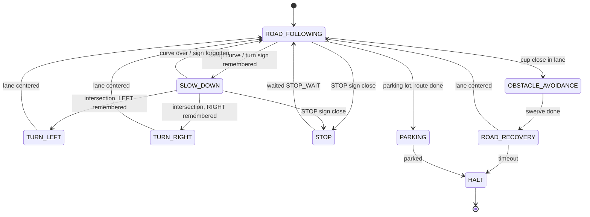

# Plan: from today's robot to the final challenge

Working plan toward `GOAL.md`. Update it as work progresses: tick steps, add results, move the "Now" marker.
Decisions that come out of it go into `DECISIONS.md`. Every step follows CLAUDE.md 6.1 (propose, go, implement,
test, approval, commit).

Version: 2026-10-26, draft 3 (no dates in the repo; order of section 6 approved, decision ORDER).

## 1. Where we are against the goal

| Milestone | Status | What exists | Gap |
| :--- | :--- | :--- | :--- |
| M1 Adaptive road following | **done** | lane model, curve model (5 classes), PD + gain scheduling + curve feedforward, curve-based speed; 60 s in both directions (`T1RUNS`, `FF2`); table `results/week1/task1_results.md` | `STEER2` (motor trim -0.01, smoothed D) still "revisit"; the table predates it |
| M2 Avoidance + recovery | **coded, not driven** | obstacle model v3, stop at a cup shown live (`DEMO1`), timed swerve + `ROAD_RECOVERY` (`AVOID1`) | track test; `PASS2` (no trigger in sharp curves) not in `decision.py` |
| M3 Signs | not started | nothing | signs are being bought |
| M4 Intersection | not started | nothing | intersection not taped yet |
| M5 Parking | not started | nothing | parking space not taped yet |
| M6 State machine | **partial** | `decision.py` with the guide's state names, `STATE_MACHINE.md` table + Mermaid (`SM1`) | structure differs from Guide #2 (section 2); TURN / PARKING / STOP-sign states missing |
| M7 ACC | not started | speed is already `min(curve speed, steering speed)` | second JetBot, lead detection, lead program, gap control |
| M8 Final + slides | not started | run logs, `analyze_runs.py`, experiment records in `DECISIONS.md` | videos, slides, data summary, ZIP |

Only the signs and the second JetBot are bought or borrowed. **The intersection and the parking space are tape on
the floor: the team can build them now (S0).**

## 2. Architecture: today vs Guide #2

| Guide #2 asks for | Our code today | Change |
| :--- | :--- | :--- |
| one `update_state(state, road, obstacle, sign)` with a fixed priority order | `Decision.update`: priority spread over early returns and the `stop_only` branch | **A2:** one `update_state` as an if/elif chain in priority order, like the slide's pseudo code; counters and timers stay in the `Decision` object |
| only the current state's behavior runs: `<state>_step(...) -> (steering, speed)` | if/elif in `drive.py`, controller methods return wheel speeds | **A3:** one `<state>_step` per state in `control.py`, each returning `(steering, speed)` (a pivot is speed 0, steering +-0.35) |
| one `set_motor_commands(steering, speed)`, the only motor write | motors written in four places in `drive.py` (lines 122, 130, 134, 138); line 138 without the watchdog lock (`REVIEW2`) | **A4:** one function: clamp, motor trim, write under the lock. Negative wheel speeds stay allowed (pivots, reversing) |
| perception returns one result per model | `Perception.observe` returns one flat dict | **A1:** `road`, `obstacle`, `sign` results; done together with the sign model (S9), not as its own step |
| avoidance sub-phases `SLOW_DOWN -> TURNING -> PASSING -> RECOVERY` | timed list `AVOID_STEPS` | **A6:** keep the list, name the phases after the guide in logs and docs |
| `ROAD_LOST -> ROAD_RECOVERY` | lane lost 0.5 s -> `HALT` | **A5, deferred to M4 and changes `AVOID1` / `SM1`:** only when turns need it. Search = pivot in place toward the side the lane was last seen, no forward motion, short timeout -> `HALT`. Driving forward blind is not safe (the lane model once said "visible 0.99" on distant tape, run `v3_ccw_3`) |

`STATE_MACHINE.md` stays hand-written next to the code (`SM1`); no generator script.

A2-A4 change no behavior. They come before the first new state (TURN, PARKING or STOP, whichever is first), so
each new state is one `<state>_step`, one branch in `update_state` and one table row.

## 3. Models: ML recognizes, scripts measure and decide

**Principle `HYBRID` (user, 2026-10-26):** combine models and Python scripts for better results. A model
recognizes (is there a lane, a cup, a sign; roughly where). Plain scripts measure exact geometry with the classical
color masks we already have (`lane_mask.py`, `cup_mask.py`) and run the maneuvers and the checks that end them. A
check that decides a state change uses a script measurement whenever one exists. First use: run `avoid_ccw_1`
(S1).

The same pipeline for every model, as for lane and cup: record sessions -> labels from a color mask or the session
settings -> spot check on review sheets -> train (`03_train.py`, epoch picked by the error that matters) ->
TensorRT -> `replay.py` before driving. Models only measure; every decision is a named constant and a branch in
`update_state`.

| Result | Network(s) | Outputs | Labels from | Used by |
| :--- | :--- | :--- | :--- | :--- |
| `road` | lane model + curve model (both exist; two networks per `D2`, a merged retrain risks an offset as in `LANE2`) | lane_visible, lane_x; curve class and direction | blue-tape mask | following, SLOW_DOWN, turn end, intersection (P2) |
| `obstacle` | obstacle model (exists; extended in M7) | cup visible / row / x; later lead visible / row / x | red-band mask; lead marker mask | AVOIDANCE, ACC |
| `sign` | sign model (new) | STOP / LEFT / RIGHT / NONE, sign x, sign size | class from the session (one sign type per session), position and size from a color mask | STOP, remembered turn |
| parking lines | mask first; a model on mask labels only if the mask fails | line offset, angle, distance to the end line | parking-line mask | PARKING |

Compute: the loop is about 46 ms with three models (curve and obstacle alternate). A fourth network shares the
slot, so the obstacle model would run every third frame. **Measure before building (S3)** and express debounce
counts in fresh model readings, not in control steps.

## 4. State machine target

Priority 1 = highest. "Interruptible by" answers the slide's "priority when multiple events occur".

| # | State | Entry | Action | Exit | Interruptible by | Milestone |
| :--- | :--- | :--- | :--- | :--- | :--- | :--- |
| 1 | `HALT` | battery, camera frozen, Ctrl-C, timeouts, mission done | motors off, run ends | none | - | exists |
| 2 | `OBSTACLE_AVOIDANCE` | cup close and in the lane for N fresh readings, not in a sharp curve (`PASS2`) | timed swerve (phases A6) | time up -> `ROAD_RECOVERY` | HALT only (blind) | exists |
| 3 | `STOP` | STOP sign close for N readings, not the sign already stopped at (`STOP_IGNORE` s) | motors off `STOP_WAIT` s | time up -> `ROAD_FOLLOWING` (a remembered turn stays remembered) | HALT | M3 |
| 4 | `TURN_LEFT` / `TURN_RIGHT` | intersection reached with a remembered LEFT / RIGHT sign (until signs exist: direction from the command line) | timed entry, then steer on the lane | lane centered for N steps -> `ROAD_FOLLOWING`; timeout -> `HALT` | HALT only (timed part) | M4 |
| 5 | `PARKING` | parking lot seen and route done | approach, align, stop inside the lines; retry: reverse and approach again | inside -> `HALT` (done); `PARK_RETRIES` used -> `HALT` | HALT, cup (-> stop, not avoid) | M5 |
| 6 | `ROAD_RECOVERY` | after the swerve; lane lost (A5, M4) | after swerve: as today; lane lost: pivot toward the last lane side | lane centered for N steps -> `ROAD_FOLLOWING`; timeout -> `HALT` | HALT | exists |
| 7 | `SLOW_DOWN` | sharp curve, **or** turn sign remembered | lane following, speed capped | curve cause: p_sharp < exit threshold; sign cause: turn started, or `SIGN_MEMORY` s passed (the sign is forgotten) | rows 1-6 | exists, extended M4 |
| 8 | `ROAD_FOLLOWING` | default | lane following, `speed = min(curve_speed, safe_following_speed)` | other rows | rows 1-7 | exists, ACC in M7 |

Intersection cases (M4): no sign -> straight through; at the stem of a T there is no straight, so a sign is
required (no sign -> `HALT`); STOP and a turn sign at the same intersection -> stop first, then turn.

Start in the parking space: a fixed opening maneuver that ends on the lane, or a start state `LEAVE_PARKING`.
Decide with the parking layout (S13).

(Target only; `notebooks/mini_av/STATE_MACHINE.md` shows what is built.)

## 5. Visualization

| What | Tool | When |
| :--- | :--- | :--- |
| V1 State table + Mermaid diagram in `STATE_MACHINE.md`, by hand (`SM1`) | GitHub renders it | with every state machine change |
| V2 Code architecture: modules, models, data flow, links to file and line | `diagrams-archify` architecture via `scripts/archify.sh`; candidate JSON + HTML in `diagrams/` | after A2-A4, at M6, for M8 |
| V3 State machine for the slides | `diagrams-archify` lifecycle from the V1 Mermaid | M6, M8 |
| V4 Slide figures (system flow, result charts) | `slop-diagrams`, built-in `dataviz` | M8 |

## 6. Steps

Each step needs the team's go and has a pass/fail test. [ ] open, [x] done. Record a video of every demo and every
step test from now on (slides).

**Now**

- [ ] **S0 Team (no code):** tape a T-intersection and a parking box on the track; ask the professor what the
  unknown course looks like (tape color, lane width, sign placement). Assign one slide topic per member.
- [ ] **S1 M2 track test.** First run `avoid_ccw_1` (2026-10-26, battery 11.0-11.2 V under load): the cup was
  detected, but (1) the turn-in after the pass pointed at the cup: the cup leaves the wide-angle image while still
  beside the front of the robot; (2) recovery turned the robot further toward the lane until it stood crosswise,
  and the lane model's lane_x near 0 on the crosswise tape ended recovery; then it drove off. Fixes (`AVOID2`,
  `HYBRID`): S1a below. Remaining S1 plan unchanged:
  - [x] **S1a** (implemented, offline tested, reviewed; not yet driven) pass phase ends only after the cup mask has not seen the cup on its side for `AVOID_PASS_CLEAR`
    (timeout -> HALT); swerve made symmetric (drive back in, turn parallel again); recovery steers on lane_x as
    before and ends only when the lane mask sees two lines one lane width apart. Pass offline: the crosswise frames of
    `avoid_ccw_1` are rejected, centered lap frames accepted (measured: 0 of the crosswise frames, 378 of 379
    centered lap frames); decision test with synthetic percepts; subagent review.
  - [x] **S1b** run `avoid_ccw_2` (2026-10-29, 12.09 V): 3 of 3 swerves ended in following, recovery under 1 s,
    but each timed turn was about 130 degrees (`MOVE2`), so the turn-in pointed back at the passed cup; the run
    ended by driving into a second JetBot standing on the lane (no JetBot detection before M7: keep other robots
    off the track). Swerve replaced (`AVOID3`, user): S1c.
  - [ ] **S1c** swerve as turn 90 degrees, curve around the cup, turn 90 degrees back (`AVOID3`).
    - [x] S1c1 camera-ended turns: spin test (`MOVE2`), `lane_mask.tape_angle`, `turn_test.py`: 5 of 5 turns
      at 90 degrees (user), 5 of 5 turns back found the lane.
    - [x] S1c2 the curve (`swerve_test.py`, no cup, robot on the center of the straight): turn out, curve right
      (`ARC_WHEELS` 0.37 / 0.30, ends when the lane edge ahead is horizontal again), turn back until `lane_found`.
      0.40 / 0.27 went only just past the inner edge; 0.37 / 0.30 is the width the user wants (curve 2.85 s).
      Open: the robot ended on the right side of the lane, almost on the outer tape (user); `lane_found` also
      fires mid-curve when the robot crosses back into the lane.
    - [ ] S1c3 swerve phases in `decision.py` / `control.py`, `STATE_MACHINE.md`, offline tests, subagent review.
    - [ ] S1c4 track runs (one cup, no other robot, filmed); pass as in S1 below.
  Original S1: Cup on a straight, 60 s runs, about 10 swerves, tune `AVOID_STEPS`. Pass: 8 of 10
  swerves end in `ROAD_FOLLOWING` without touching the robot. Same runs decide `STEER2` (keep if no lane loss).
  Then the M2 demo.
- [ ] **S2 PASS2** in `decision.py` (no cup trigger while the curve model says sharp). Pass: replay of cup sessions
  shows the same triggers on straights, none in sharp curves.
- [ ] **S3 Compute check:** load a fourth (untrained) TensorRT ResNet18 next to the three, motors off. Pass: loop
  time and free memory logged; decide the model schedule before S9.
- [ ] **S4 Restructure A2-A4 (+A6 names).** Pass: offline, recorded percepts through old and new `update_state`
  give the same state at every step; one 60 s run per direction and one avoid run match S1 within normal spread
  (`compare_runs.py`, moved from the USB stick into the repository first).
- [ ] **S5 V2 Archify architecture diagram.** Pass: Archify checks pass; the team can explain every box.
- [ ] **S6 Task 1 table refresh** with the S1 settings (slides).

**M5 Parking (as soon as the box is taped)**

- [ ] **S7 Parking survey:** line color, mask, where the box is relative to the road; decide the start maneuver.
- [ ] **S8 PARKING** state: approach, align, final stop, retry. Pass: 8 of 10 parkings fully inside the lines,
  measured offset from the box center in a table.

**M4 Intersection (as soon as it is taped; direction from the command line until signs exist)**

- [ ] **S9a Intersection survey + P2** (how to detect it).
- [ ] **S9b TURN_LEFT / TURN_RIGHT, straight-through, A5.** Pass: 10 turns each way and 5 straight passes, lane
  reacquired every time; lane removed after a turn -> stops within the timeout.

**M3 Signs (when they arrive)**

- [ ] **S10 Sign survey:** photos at 20 / 40 / 60 cm, both sides, sunlight and evening. Pass: 0 cup detections
  (cup mask and obstacle model) and no lane_x change on the sign photos; sign readable at the planned distance.
  Decide capture size or crop **before** recording.
- [ ] **S11 Sign data, labels, sign model, A1.** Task 3 "demonstrated recognition problem": measure the miss rate
  over distance (or light), make one change (data for the weak case, crop, or color jitter), measure again.
- [ ] **S12 STOP state + remembered turn.** Pass: 10 approaches stop every time, one stop per sign; remembered
  turn drives the S9b turn.

**M6 Integration**

- [ ] **S13 Combined course:** parking -> lap with cup, STOP, turn -> parking. Pass: 3 of 5 full runs without
  touching the robot. V1, V2, V3 updated; full state table.

**M7 ACC (when a second JetBot is available)**

- [ ] **S14 Lead JetBot program** (constant speed, scripted stop and restart) and marker (Q4).
- [ ] **S15 Lead detection:** obstacle model extended with lead visible / row / x.
- [ ] **S16 ACC:** gap -> safe following speed; stop below a stop gap, go above a larger go gap (hysteresis, the robot
  does not move below wheel speed 0.27); existing rate limits. Pass: the guide's tests (constant lead, lead stops,
  lead restarts, straight and curve) with gap and speed graphs, no stop-go oscillation.

**M8 Final**

- [ ] **S17 Robustness:** new sessions in changed light and positions through `replay.py`; fix the weakest case.
- [ ] **S18 Slides** (one per member, `slop-prose` for text, V2-V4 figures), training/test data summary (why each
  dataset was added, what it fixed), graphs and tables, video, ZIP `StudentID_Name_mmddyyyy_DataMining.zip`.

## 7. Risks

| Risk | Check |
| :--- | :--- |
| Red STOP sign read as a cup: AVOIDANCE outranks STOP, the robot would swerve at the sign | S10: 0 cup detections on sign photos; else sign frames as negatives in obstacle training, or cups only below a row |
| Blue LEFT / RIGHT signs disturb the lane | S10 |
| Signs too small at 224x224 | S10, decided before recording |
| Unknown course uses other tape or lanes than our blue oval | S0 question to the professor; S17 |
| Fourth network: slower loop, less memory (low memory froze the camera, chair incident) | S3 |
| Timed maneuvers drift with the battery (no encoders, `MOVE1`) | short blind phases, every maneuver ends on the camera |
| Lane-lost recovery drives off the track | A5 only as a pivot without forward motion, short timeout |
| ACC stop-go oscillation from the speed dead band | hysteresis gaps (S16) |

## 8. Open questions

| ID | Question | Who |
| :--- | :--- | :--- |
| P2 | Intersection detection: road model output with mask labels (crossing line, lane widening), the sign as trigger at a fixed distance, or both | team, after S9a |
| Q3 | When do the signs and a second JetBot arrive; sign sizes and colors | team |
| Q4 | May the lead JetBot carry a marker (like the cup band)? | team / professor |
| Q5 | How does the robot know the route is done (laps, a sign, the parking lot seen)? | team, course rules |

## 9. Change log

| Date | Change |
| :--- | :--- |
| 2026-10-26 | Draft 1 |
| 2026-10-26 | Draft 2 after critical review (section 10) |
| 2026-10-26 | S1 first run failed; principle HYBRID; S1a fixes |
| 2026-10-26 | Draft 3: deadlines removed (user: not for the repo); order approved: S4 restructure before M3-M5 (`ORDER`) |
| 2026-10-29 | S1b run; turn rates measured (`MOVE2`); new swerve with camera-ended turns (`AVOID3`), S1c1 done |

## 10. Review of draft 1 (2026-10-26, independent reviewer agent)

Taken: intersection and parking are tape, build now (S0); if/elif
`update_state` instead of a transition table; no diagram generator (keeps `SM1`); A1 with the sign model; A5
deferred to M4 as a pivot search; "interruptible by" column, separate SLOW_DOWN exits, sign memory timeout,
straight-through and T-stem cases; compute check before the sign model; debounce in fresh readings; S10 with
numbers and the capture size decided before recording; ACC hysteresis and a lead program; videos from now on,
slide owners early; numeric pass criteria; `compare_runs.py` into the repository; `PASS2` gap; P1 settled by `D2`
and `LANE2`. Verified in the code: four motor writes in `drive.py`, one outside the watchdog lock.
Not taken: deadline as blocker plus cut list (user: no deadlines in the repo).
Partly taken: Task 3 framing. The slide asks to "use the data to solve a demonstrated recognition problem such
as distance", so data aimed at a measured weakness counts; S11 allows data, crop or jitter as the one change.
