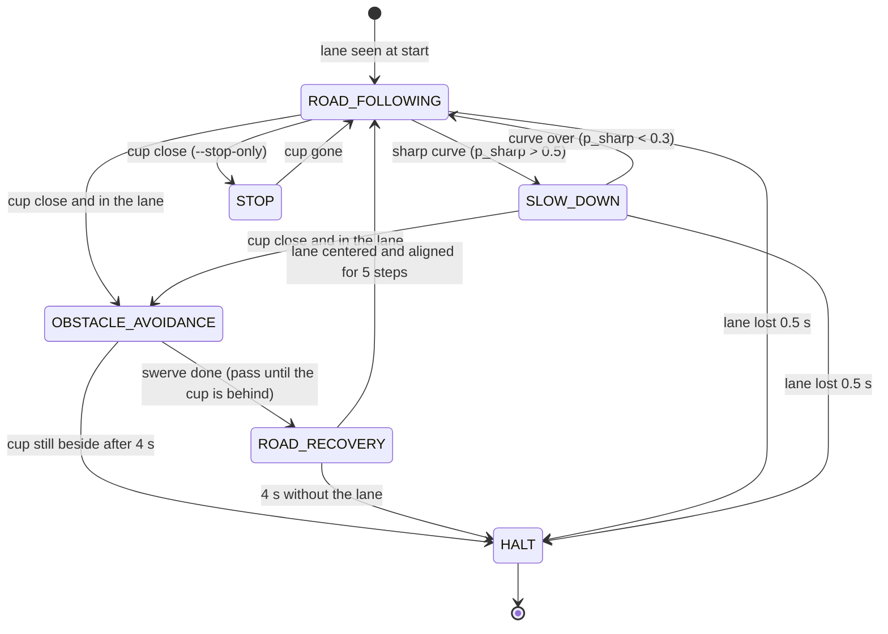

# State machine (Task 6)

The code is `decision.py` (when to switch) and `control.py` (what each state does). This file and the code
change together: every version of `decision.py` must match this table and diagram. Constants are in `config.py`.

Version: 2026-10-26 (AVOID2: pass guided by the cup mask, symmetric swerve, recovery needs an aligned lane; turns,
STOP sign and parking planned).

## States

Priority 1 is the highest: when several conditions hold at once, the state with the higher priority wins.

| State | Priority | Entry condition | Action / control | Exit condition |
| :--- | :--- | :--- | :--- | :--- |
| `HALT` | 1 | lane not seen for 0.5 s (`LANE_LOST_TIMEOUT`) while following; recovery timeout; cup still beside the robot after `AVOID_PASS_MAX`; no lane at the start; battery low, camera frozen or Ctrl-C (in `drive.py`) | motors off, run ends, reason logged | none (end of run) |
| `OBSTACLE_AVOIDANCE` | 2 | a cup is close (band row >= `OBSTACLE_ROW`, about 25-35 cm stop distance) **and** in the lane (abs(cup_x - lane_x) < `CUP_IN_LANE`) for `OBSTACLE_FRAMES` steps | swerve to the inside of the oval in phases (`AVOID_STEPS`): turn 45 deg out, out, turn parallel, pass, turn 45 deg in, in, turn parallel. All timed except the pass: at least 1.4 s, then until the cup mask has not seen the cup (a band of at least `AVOID_BESIDE_PIXELS` on the cup's side) for `AVOID_PASS_CLEAR` (HYBRID). Lane and lane-lost rule ignored | last phase done -> `ROAD_RECOVERY`; cup still beside after `AVOID_PASS_MAX` -> `HALT` |
| `ROAD_RECOVERY` | 2 | swerve done | lane not seen: slowly forward, turning gently away from the pass side (`RECOVER_SPEED`, `RECOVER_TURN`); lane seen: normal steering | lane seen, aligned (lane mask: two lines about one lane width apart) and abs(lane_x) < `RECOVER_CENTERED` for `RECOVER_FRAMES` steps -> `ROAD_FOLLOWING` (a distant or crosswise lane does not count); `RECOVER_TIMEOUT` (4 s) -> `HALT` |
| `STOP` | 3 | required stop. Now: `--stop-only` and a close cup (any position) for `OBSTACLE_FRAMES` steps. Planned: STOP sign | motors off, wait | cup gone (unseen or band row < `OBSTACLE_CLEAR_ROW`) for `OBSTACLE_CLEAR_FRAMES` steps -> `ROAD_FOLLOWING` |
| `SLOW_DOWN` | 4 | sharp curve ahead: p_sharp > `SLOW_DOWN_ENTER`. Planned: intersection ahead | lane following, speed capped at `SPEED_SHARP` | p_sharp < `SLOW_DOWN_EXIT` -> `ROAD_FOLLOWING` |
| `ROAD_FOLLOWING` | 5 | start (lane seen), recovery done, stop over, curve over | lane following: PD steering with curve feedforward, speed from the curve model (Task 1) | see the entry conditions of the other states |
| `TURN_LEFT` / `TURN_RIGHT` | 3 | planned: intersection detected and LEFT / RIGHT sign seen before it | planned: slow down, enter the turn, reacquire the road | planned: lane found -> `ROAD_FOLLOWING` |
| `PARKING` | 3 | planned: parking lot reached at the end of the route | planned: approach, align, stop inside the lines, retry if outside | planned: stopped inside the lines -> `HALT` |

Rules that hold in every state:
- The pass side is the inside of the oval, measured from the curve direction during the run (left until the
  first curve), or fixed with `--pass-side`.
- A short lane gap (under 0.5 s) while following keeps steering without lane_x (`Controller.hold`).
- Entering `OBSTACLE_AVOIDANCE` or `STOP` resets the controller, so the robot starts slowly afterwards.

## Diagram

Planned states (`TURN_LEFT`, `TURN_RIGHT`, `PARKING`, `STOP` for a sign) are added to the diagram when they are
coded.
