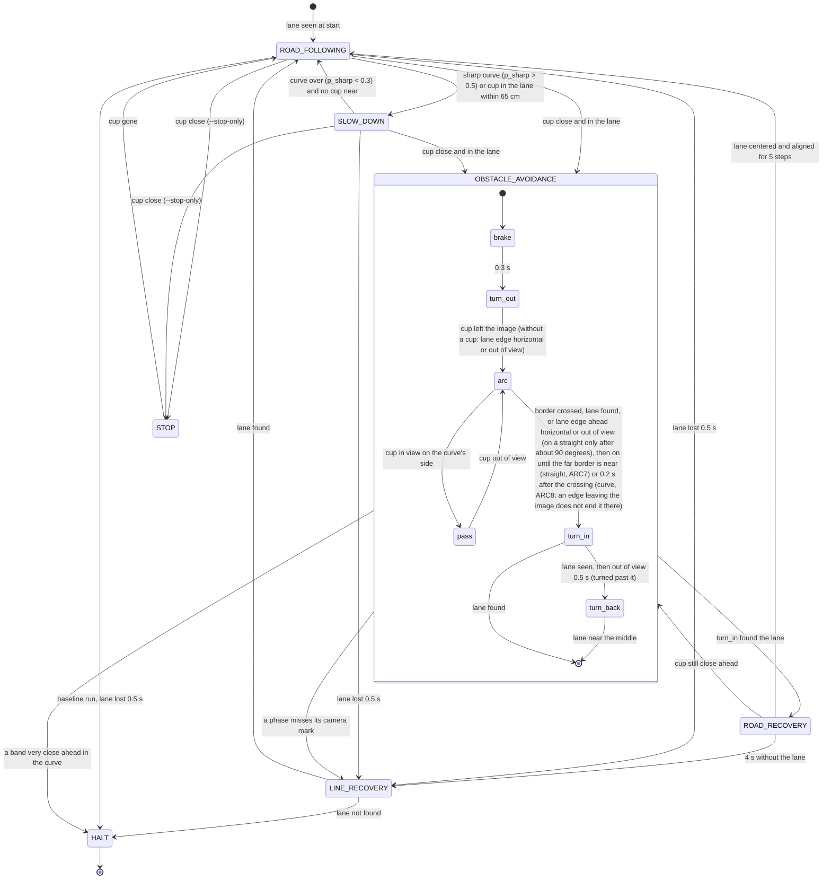

# State machine (Task 6)

The code is `decision.py` (when to switch) and `control.py` (what each state does). This file and the code
change together: every version of `decision.py` must match this table and diagram. Constants are in `config.py`.

Version: 2026-11-26 (ARC9: the swerve curve with `MOTOR_TRIM`, passing right 0.29 / 0.39, so both sides curve alike. ARC7, ARC8: on a straight, after the border crossing the turn in starts when the far border comes as near as from the lane's middle, `TAPE_MIDDLE_ROW`, `ARC_PAST` at the latest; in a curve `ARC_PAST_CURVE` after the crossing. ARC5: on a straight the turn in starts `ARC_PAST` 0.5 s after the border crossing, about 12 cm; ARC6: a sharper swerve curve, `ARC_WHEELS` 0.37 / 0.31, its angle limits scaled. RECOV3: a short lane gap in ROAD_RECOVERY after the lane was seen is held into the curve like in following; STEER3 undone. PASS3: a cup in a curve is always passed on the inside of that curve, both ways round. ARC4: the 5 cm on count from the border crossing, none with the far line ahead; SIT4: LINE_RECOVERY accepts the lane center up to `IN_LANE_CENTER` 1.0 with the lane at most `IN_LANE_HEADING` off. ARC2: after the curve's end mark straight on `ARC_PAST` before the turn in; ARC3: with the cup in a curve bending toward the pass side the curve ends on the earlier marks. 2026-11-19: ARC1: the curve turns about 90 degrees before it may end; TURN2: the turn back accepts a curved lane bending the driving way. 2026-11-18: DIR1: the driving direction from the first sharp curve, kept all run; TURN1: a turn back past the lane turns the other way; RECOV2: a cup close ahead in ROAD_RECOVERY starts a new swerve. 2026-11-08: LINE1: LINE_RECOVERY finds a lost lane again; OBST9: the cup's distance comes from the band's size; OBST8: the cup mask alone slows the robot, a cup straight ahead counts without the lane; AVOID4: the turn out ends
when the cup leaves the image, the curve drives straight while the cup is in view on its side; recovery needs an
aligned lane; turns, STOP sign and parking planned).

## States

Priority 1 is the highest: when several conditions hold at once, the state with the higher priority wins.

| State | Priority | Entry condition | Action / control | Exit condition |
| :--- | :--- | :--- | :--- | :--- |
| `HALT` | 1 | lane not found by `LINE_RECOVERY`; in baseline runs lane not seen for 0.5 s; a band very close ahead during the curve; no lane at the start; battery low, camera frozen or Ctrl-C (in `drive.py`) | motors off, run ends, reason logged | none (end of run) |
| `OBSTACLE_AVOIDANCE` | 2 | the cup mask's nearest red band in the way (abs(band x - lane_x) < `CUP_IN_LANE`, or abs(band x) < `CUP_DEAD_AHEAD` without needing the lane) is within `OBSTACLE_CM` (40 cm, from the band's size: `CUP_SIZE_CM` / sqrt(pixels)) **and** the obstacle model sees a cup, for `OBSTACLE_FRAMES` steps (HYBRID: the model's own distance was wrong with people behind the cup) | swerve to the inside of the oval in phases (`AVOID_PHASES`); with the cup in a curve (curve model at the end of `brake`: gentle + sharp at least 0.5, `curve_dir` at least `DIRECTION_MIN_DIR`) always to the inside of that curve (PASS3); the turns and the curve each ended by a camera mark (HYBRID): `brake` reverse pulse `BRAKE`, then standing still, `AVOID_BRAKE` in all; `turn_out` turns in place toward the pass side (kick, then `TURN_SPEED`) until the cup has left the image sideways (last seen beyond `CUP_EDGE`); without a cup in view until the lane edge is `TURN_EARLY` before horizontal, or leaves the image after being within `TURN_LOST` of horizontal (about 90 degrees); `arc` curves around the cup (`ARC_WHEELS`), straight on (`ARC_STRAIGHT`, action `pass`) while a band within `CUP_NEAR_CM` is in view on the side the curve bends to, straight on after `ARC_STRAIGHT_AFTER` once the minimum turn is reached, and only after `ARC_TURN_MIN` seconds of curving (about 90 degrees back; straight parts do not count) until the lane's border has been crossed (lowest tape row reached `TAPE_UNDER_ROW` after `ARC_MIN`, then back above `TAPE_PAST_ROW`), or the lane is found, or the edge ahead is `ARC_EARLY` before horizontal or leaves the image (facing the lane); with the cup in a curve bending toward the pass side (curve model at the end of `brake`: gentle + sharp at least 0.5, `curve_dir` at least `DIRECTION_MIN_DIR` toward the pass side) the road comes back early, so there is no `ARC_TURN_MIN`: border crossed, the lane found after `ARC_LANE_MIN`, or facing the lane after `ARC_MIN` (ARC3); after the end mark straight on until `ARC_PAST` (0.5 s, about 12 cm; in a curve `ARC_PAST_CURVE`, 0.2 s; action `pass`) after the border crossing, so the turn in starts near the lane's middle (ARC2, ARC4, ARC5; no more when the crossing was long before; in a curve none when the far line is ahead); `turn_in` turns toward the pass side for at least `TURN_IN_MIN` until the lane is aligned and within `TURN_IN_CENTERED`, or the lane model is at `TURN_BACK_SURE` with the lane within `TURN_IN_CENTERED` and the curve model sees it bend the driving way (`DIR1`); if the lane was seen in it and has then been out of view for `TURN_PAST` (after `TURN_IN_MIN`), `turn_back` turns the other way until the lane model is at `TURN_BACK_SURE` with the lane within `TURN_IN_CENTERED` (no two-line check). Lane-lost rule ignored | `turn_in` or `turn_back` done -> `ROAD_RECOVERY`; `turn_back` longer than `TURN_BACK_MAX` -> `LINE_RECOVERY`; a phase longer than `TURN_OUT_MAX`, `ARC_MAX` or `TURN_IN_MAX` -> `LINE_RECOVERY`; during `arc` a band within `ARC_STOP_CM` and within `ARC_STOP_X` of the middle -> `HALT` |
| `LINE_RECOVERY` | 2 | the lane is lost while following (0.5 s), `RECOVER_TIMEOUT`, or a phase of the swerve misses its mark. Not in baseline runs | `find_lane.py`, from quick to thorough: (1) undo: the last 1.5 s of wheel commands backwards, only right after following, at most `UNDO_TRIES` in a row; (2) sweep: about 100 degrees to each side, first where the lane should be; (3) search in small steps with the motors off between them: one full turn looking for the lane (aligned, centered, lane model sure, tape close; or `situation.py` reads 'in lane' within `IN_LANE_CENTER` with the lane at most `IN_LANE_HEADING` off and the lane model at `UNDO_SURE`; confirmed over `CONFIRM_FRAMES`, right after following within `HEADING_WINDOW` of the start heading until the last round); not found: turn the shorter way to the nearest tape and drive across it, then the next round (`ROUNDS`); no forward pulse with a cup close ahead | lane found -> `ROAD_FOLLOWING` (the driving direction is kept, `DIR1`); not found -> `HALT`; time up or stopped by hand -> run ends |
| `ROAD_RECOVERY` | 2 | swerve done | lane seen: normal steering, which brings the robot back to the center (the swerve can end off-center); lane seen within `LANE_LOST_TIMEOUT`: held into the curve as in following (`Controller.hold`, RECOV3); lane not seen: slowly forward, turning gently away from the pass side (`RECOVER_SPEED`, `RECOVER_TURN`) | lane seen, aligned (lane mask: two lines about one lane width apart) and abs(lane_x) < `RECOVER_CENTERED` for `RECOVER_FRAMES` steps -> `ROAD_FOLLOWING` (a distant or crosswise lane does not count); a cup close ahead (as for `OBSTACLE_AVOIDANCE`) for `OBSTACLE_FRAMES` steps -> `OBSTACLE_AVOIDANCE` (a new swerve); `RECOVER_TIMEOUT` (4 s) -> `LINE_RECOVERY` |
| `STOP` | 3 | required stop. Now: `--stop-only` and a close cup in the lane (as above) for `OBSTACLE_FRAMES` steps. Planned: STOP sign | `STOP_PHASES`: `brake` reverse pulse `BRAKE` (the motors coast at 0); `wait` motors off; once per stop `back`: slowly backwards (`BACKUP_SPEED`) while the nearest band is within `BACKUP_CM` (20 cm), until further than `BACKUP_TARGET_CM` or `BACKUP_MAX` | no red band within `OBSTACLE_CLEAR_CM` anywhere (the cup can hide the lane) **and** the lane visible (a hand in front of the camera hides both) for `OBSTACLE_CLEAR_FRAMES` steps -> `ROAD_FOLLOWING` |
| `SLOW_DOWN` | 4 | sharp curve ahead: p_sharp > `SLOW_DOWN_ENTER`; or the cup mask finds a cup in the way within `APPROACH_CM` (65 cm, the model is not asked), so the robot rolls on less after a stop. Planned: intersection ahead | lane following, speed capped at `SPEED_SHARP` | p_sharp < `SLOW_DOWN_EXIT` and no cup within the approach distance -> `ROAD_FOLLOWING` |
| `ROAD_FOLLOWING` | 5 | start (lane seen), recovery done, stop over, curve over | lane following: PD steering with curve feedforward, speed from the curve model (Task 1) | see the entry conditions of the other states |
| `TURN_LEFT` / `TURN_RIGHT` | 3 | planned: intersection detected and LEFT / RIGHT sign seen before it | planned: slow down, enter the turn, reacquire the road | planned: lane found -> `ROAD_FOLLOWING` |
| `PARKING` | 3 | planned: parking lot reached at the end of the route | planned: approach, align, stop inside the lines, retry if outside | planned: stopped inside the lines -> `HALT` |

Rules that hold in every state:
- The pass side is the inside of the oval: the driving direction is decided once at the first sharp curve (5 steps
  in a row with p_sharp >= `DIRECTION_SHARP` and abs(curve_dir) >= `DIRECTION_MIN_DIR`, right = clockwise) and kept
  for the whole run (`DIR1`); left until then; `--pass-side` fixes it.
- A short lane gap (under 0.5 s) while following keeps steering without lane_x (`Controller.hold`).
- Entering `OBSTACLE_AVOIDANCE` or `STOP` resets the controller, so the robot starts slowly afterwards.

## Diagram

Planned states (`TURN_LEFT`, `TURN_RIGHT`, `PARKING`, `STOP` for a sign) are added to the diagram when they are
coded.
