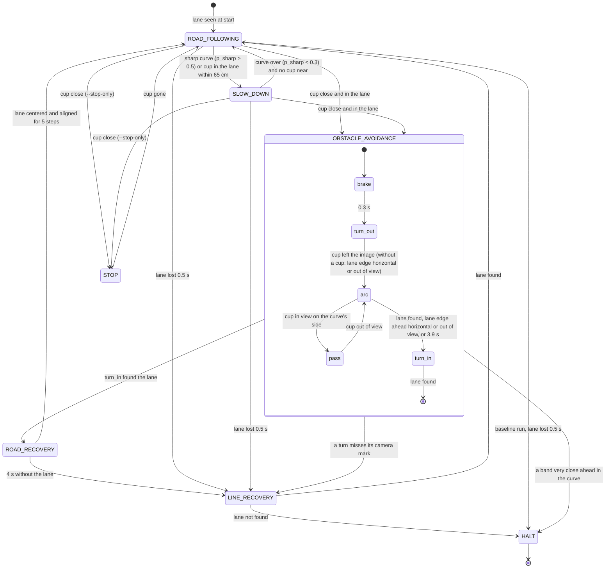

# State machine (Task 6)

The code is `decision.py` (when to switch) and `control.py` (what each state does). This file and the code
change together: every version of `decision.py` must match this table and diagram. Constants are in `config.py`.

Version: 2026-11-08 (LINE1: LINE_RECOVERY finds a lost lane again; OBST9: the cup's distance comes from the band's size; OBST8: the cup mask alone slows the robot, a cup straight ahead counts without the lane; AVOID4: the turn out ends
when the cup leaves the image, the curve drives straight while the cup is in view on its side; recovery needs an
aligned lane; turns, STOP sign and parking planned).

## States

Priority 1 is the highest: when several conditions hold at once, the state with the higher priority wins.

| State | Priority | Entry condition | Action / control | Exit condition |
| :--- | :--- | :--- | :--- | :--- |
| `HALT` | 1 | lane not found by `LINE_RECOVERY`; in baseline runs lane not seen for 0.5 s; a band very close ahead during the curve; no lane at the start; battery low, camera frozen or Ctrl-C (in `drive.py`) | motors off, run ends, reason logged | none (end of run) |
| `OBSTACLE_AVOIDANCE` | 2 | the cup mask's nearest red band in the way (abs(band x - lane_x) < `CUP_IN_LANE`, or abs(band x) < `CUP_DEAD_AHEAD` without needing the lane) is within `OBSTACLE_CM` (40 cm, from the band's size: `CUP_SIZE_CM` / sqrt(pixels)) **and** the obstacle model sees a cup, for `OBSTACLE_FRAMES` steps (HYBRID: the model's own distance was wrong with people behind the cup) | swerve to the inside of the oval in phases (`AVOID_PHASES`), the turns and the curve each ended by a camera mark (HYBRID): `brake` reverse pulse `BRAKE`, then standing still, `AVOID_BRAKE` in all; `turn_out` turns in place toward the pass side (kick, then `TURN_SPEED`) until the cup has left the image sideways (last seen beyond `CUP_EDGE`); without a cup in view until the lane edge is `TURN_EARLY` before horizontal, or leaves the image after being within `TURN_LOST` of horizontal (about 90 degrees); `arc` curves around the cup (`ARC_WHEELS`), straight on (`ARC_STRAIGHT`, action `pass`) while a band within `CUP_NEAR_CM` is in view on the side the curve bends to, until `ARC_LONGEST`, or until the lane is found while crossing it (after `ARC_LANE_MIN`), or for at least `ARC_MIN` until the edge ahead is `ARC_EARLY` before horizontal or leaves the image (facing the lane); `turn_in` turns toward the pass side for at least `TURN_IN_MIN` until the lane is aligned and within `TURN_IN_CENTERED`. Lane-lost rule ignored | `turn_in` done -> `ROAD_RECOVERY`; a turn longer than `TURN_OUT_MAX` or `TURN_IN_MAX` -> `HALT`; during `arc` a band within `ARC_STOP_CM` and within `ARC_STOP_X` of the middle -> `HALT` |
| `LINE_RECOVERY` | 2 | the lane is lost while following (0.5 s), `RECOVER_TIMEOUT`, or a turn of the swerve misses its mark. Not in baseline runs | `find_lane.py`, in small steps with the motors off between them: turn left about one full turn looking for the lane (aligned, centered, lane model sure, tape close); not found: turn to the nearest tape and drive across it, then the next round (`ROUNDS`); no forward pulse with a cup close ahead | lane found -> `ROAD_FOLLOWING` (the driving direction is measured anew: the robot may face either way); not found after `ROUNDS` -> `HALT` |
| `ROAD_RECOVERY` | 2 | swerve done | lane seen: normal steering, which brings the robot back to the center (the swerve can end off-center); lane not seen: slowly forward, turning gently away from the pass side (`RECOVER_SPEED`, `RECOVER_TURN`) | lane seen, aligned (lane mask: two lines about one lane width apart) and abs(lane_x) < `RECOVER_CENTERED` for `RECOVER_FRAMES` steps -> `ROAD_FOLLOWING` (a distant or crosswise lane does not count); `RECOVER_TIMEOUT` (4 s) -> `HALT` |
| `STOP` | 3 | required stop. Now: `--stop-only` and a close cup in the lane (as above) for `OBSTACLE_FRAMES` steps. Planned: STOP sign | `STOP_PHASES`: `brake` reverse pulse `BRAKE` (the motors coast at 0); `wait` motors off; once per stop `back`: slowly backwards (`BACKUP_SPEED`) while the nearest band is within `BACKUP_CM` (20 cm), until further than `BACKUP_TARGET_CM` or `BACKUP_MAX` | no red band within `OBSTACLE_CLEAR_CM` anywhere (the cup can hide the lane) **and** the lane visible (a hand in front of the camera hides both) for `OBSTACLE_CLEAR_FRAMES` steps -> `ROAD_FOLLOWING` |
| `SLOW_DOWN` | 4 | sharp curve ahead: p_sharp > `SLOW_DOWN_ENTER`; or the cup mask finds a cup in the way within `APPROACH_CM` (65 cm, the model is not asked), so the robot rolls on less after a stop. Planned: intersection ahead | lane following, speed capped at `SPEED_SHARP` | p_sharp < `SLOW_DOWN_EXIT` and no cup within the approach distance -> `ROAD_FOLLOWING` |
| `ROAD_FOLLOWING` | 5 | start (lane seen), recovery done, stop over, curve over | lane following: PD steering with curve feedforward, speed from the curve model (Task 1) | see the entry conditions of the other states |
| `TURN_LEFT` / `TURN_RIGHT` | 3 | planned: intersection detected and LEFT / RIGHT sign seen before it | planned: slow down, enter the turn, reacquire the road | planned: lane found -> `ROAD_FOLLOWING` |
| `PARKING` | 3 | planned: parking lot reached at the end of the route | planned: approach, align, stop inside the lines, retry if outside | planned: stopped inside the lines -> `HALT` |

Rules that hold in every state:
- The pass side is the inside of the oval, measured from the curve direction during the run (left until the
  first curve), or fixed with `--pass-side`.
- A short lane gap (under 0.5 s) while following keeps steering without lane_x (`Controller.hold`).
- Entering `OBSTACLE_AVOIDANCE` or `STOP` resets the controller, so the robot starts slowly afterwards.

## Diagram

Planned states (`TURN_LEFT`, `TURN_RIGHT`, `PARKING`, `STOP` for a sign) are added to the diagram when they are
coded.
